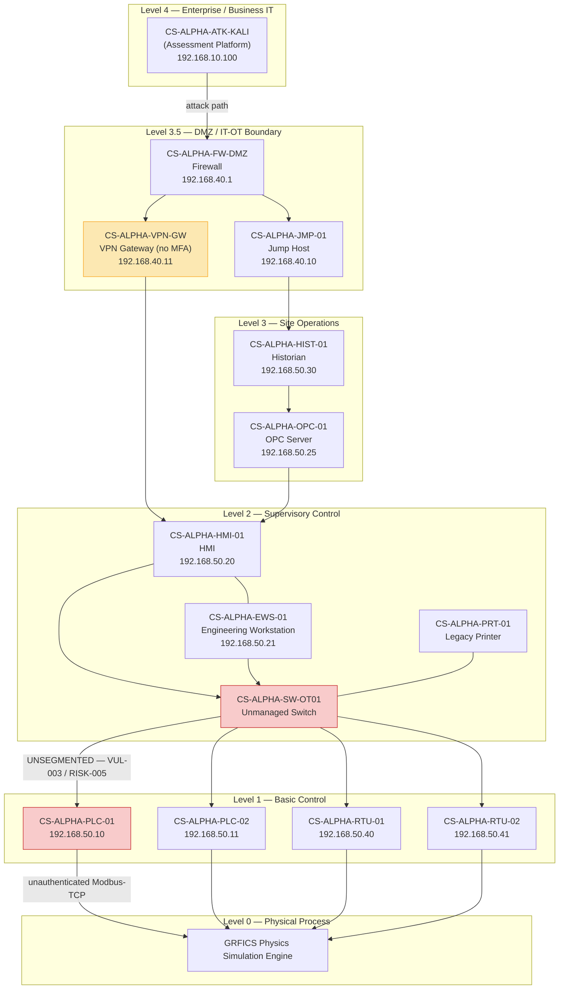

# Network Architecture — Purdue Model View

Compressor Station Alpha (simulated GRFICS lab environment), Keystone Gas & Electric.

**Key architectural finding illustrated above:** the single unmanaged OT switch (`CS-ALPHA-SW-OT01`) provides no VLAN or firewall enforcement between Level 2 (HMI/EWS) and Level 1 (PLC/RTU) — this is the network path underlying **RISK-005** (flat network segmentation) in the [risk assessment report](../docs/risk-assessment-report.md). The VPN gateway lacking MFA is the most likely initial entry point (**RISK-003**), and the unauthenticated Modbus-TCP path from PLC to the physics engine is **RISK-001**.
